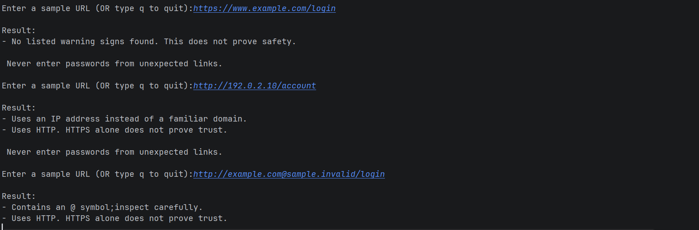
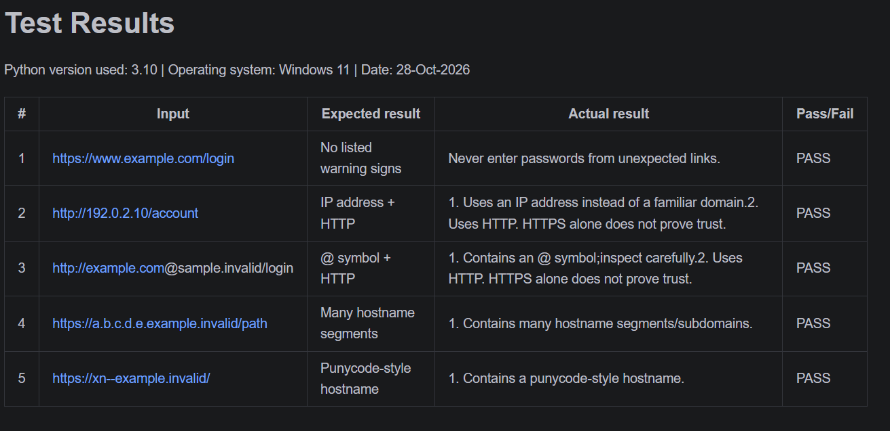

# EWB Phishing URL Awareness Checker

## Overview
This is a simple command-line Python tool that inspects the text of a URL and flags common visual warning signs used in phishing links.

## Features
- Detects an @ symbol in the URL
- Flags unusually long URLs (over 100 characters)
- Flags IP-address hostnames
- Flags many hostname segments (5 or more)
- Flags punycode-style hostnames (xn--)
- Flags the HTTP scheme
- **Continuous Loop:** The program runs continuously in a while loop until the user types 'q' to quit.
- **Crash Prevention:** Uses a try-except block to handle malformed URLs (like `http://[bad`) safely without crashing.

## Requirements
Python 3.10 or later. No extra packages needed.

## How to Run
Windows: python phishing_checker.py
Mac/Linux: python3 phishing_checker.py

## Example Output
Result:
- Uses an IP address instead of a familiar domain.
- Uses HTTP. HTTPS alone does not prove trust.
Never enter passwords from unexpected links.

## Testing
| # | Input | Expected result | Actual result | Pass/Fail |
|---|---|---|---|---|
| 1 | https://www.example.com/login | No warning signs | No listed warning signs found. This does not prove safety. | PASS |
| 2 | http://192.0.2.10/account | IP address + HTTP | Uses an IP address... Uses HTTP... | PASS |
| 3 | http://example.com@sample.invalid/login | @ symbol + HTTP | Contains an @ symbol... Uses HTTP... | PASS |
| 4 | https://a.b.c.d.e.example.invalid/path | Many hostname segments | Contains many hostname segments/subdomains. | PASS |
| 5 | https://xn--example.invalid/ | Punycode-style hostname | Contains a punycode-style hostname. | PASS |

## Screenshots

## Improvements
1. **Loop with quit:** Added a `while True` loop so the user can check multiple URLs without restarting the program. Type 'q' to quit.
2. **Stop crashes on malformed input:** Added a `try-except` block to catch `ValueError` during URL parsing, preventing the program from crashing on invalid inputs like `http://[bad`.

## Limitations
This is an educational tool. It only reads URL text. It does not visit URLs, scan for malware, or prove that a URL is safe. No warning signs found does NOT mean a URL is safe.

## Ethical Use
Use sample strings only. Do not collect credentials. Do not use this project to deceive anyone or to test websites without permission.

## Author
Ankit pathar ,www.linkedin.com/in/ankit-pathar-16b86b367, L.D. College of Engineering, EWB Courses